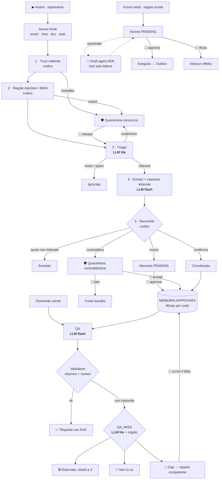

# Flusso del Company Brain (schema per le slide)

Schema di come una fonte diventa memoria, come il Brain risponde e come nascono le azioni.
Riflette il codice al 21/11. Dettagli in [architecture.md](architecture.md); codice in `src/backend/app/`.

**Il punto chiave:** il modello compare solo in 5 punti (triage, extract, qa, qa_miss, draft agent).
Cosa entra in memoria, cosa va in quarantena e cosa viene eseguito lo decidono il codice o una persona.

Più sotto c'è anche una versione Mermaid: si incolla su https://mermaid.live per esportare PNG o SVG.

## 1 · Ingresso: dalla fonte alla memoria (`pipeline/observe.py`, `pipeline/trust.py`)

```
  ▶ Avanti (timeline.json)     POST /api/events ("Mettilo alla prova")
              └──────────────┬──────────────┘
                             ▼
                      ┌──────────────┐
                      │ nuova FONTE  │  email · chat · doc · task
                      └──────┬───────┘
                             ▼
  ┌──────────────────────────────────────────────────┐
  │ [1] TRUST mittente          codice, no LLM       │──lookalike───┐
  │     internal / known_external / unknown          │              │
  ├──────────────────────────────────────────────────┤              │
  │ [2] REGOLE regex   injection · IBAN/nuovo conto  │──match───────┤
  ├──────────────────────────────────────────────────┤              │
  │ [3] TRIAGE                   LLM flash-lite      │──suspicious──┤
  │     noise/spam ──────────────────────► IGNORATA  │              ▼
  ├──────────────────────────────────────────────────┤   ┌──────────────────────┐
  │ [4] EXTRACT                  LLM flash           │   │ 🛡 QUARANTENA        │
  │     vede solo la memoria visibile a TUTTI i      │   │    SICUREZZA         │
  │     lettori della fonte                          │   └──────────────────────┘
  │     → candidati {text, quote, memory_id,         │
  │                  relation, value}                │
  ├──────────────────────────────────────────────────┤
  │ [5] RECONCILE                codice, no LLM      │
  │     quote non letterale ────────► SCARTATO       │
  │     contraddice approvata ──────► 🛡 QUARANTENA  │
  │                                    CONTRADDIZIONE│
  │     conferma esistente ─────────► CORROBORATA    │
  │                                    (+1 fonte)    │
  │     nuovo ──────────────────────► memoria PENDING│
  └──────────────────────────────────────────────────┘
```

## 2 · Decisioni umane (`services/curation.py`)

Solo le persone decidono, quarantene comprese.

```
  memoria PENDING ───── chi ha l'authority ──┬─► APPROVED ─┐
                                             └─► REJECTED  │
                                                           │
  🛡 contraddizione ── authority ──┬─ ban    → fonte bandita, memoria invariata
                                   └─ accept → memoria aggiornata (+ ordine)
  🛡 sicurezza ── reparto ─────────┬─ confirm_bad → resta scartata
                                   └─ release → torna allo step [3]
                                                (i fatti restano PENDING)
                                                           │
                                                           ▼
                                        ╔══════════════════════════════╗
                                        ║  MEMORIA APPROVATA           ║
                                        ║  usable_memory(ruolo):       ║
                                        ║  approved + visibile al      ║
                                        ║  ruolo + fonti non bandite   ║
                                        ╚══════════════╤═══════════════╝
```

## 3 · Uscita: domanda e risposta (`services/qa.py`, `services/gaps.py`)

```
  utente chiede ─► /api/ask                                       │
                     ▼                                            │
             ┌─────────────────┐ ◄──── solo memoria utilizzabile ─┘
             │ QA   LLM flash  │
             └────────┬────────┘
                      ▼
             ┌─────────────────┐  citazioni = id validi?
             │ VALIDATORE      │  ogni numero è nelle fonti?
             └───┬─────────┬───┘  (se no → testo della memoria)
          risponde      non risponde
                 ▼            ▼
       ✅ RISPOSTA       ┌──────────────────────────────┐
          + citazioni    │ QA_MISS  LLM lite + rete     │
                         │          deterministica      │
                         └┬────────┬─────────┬─────────┬┘
                          ▼        ▼         ▼         ▼
                    🔒 riservata  in        fuori     tema
                    "chiedi a X"  revisione perimetro aziendale
                    (no contenuto) "non lo   "non lo    │
                                  uso ancora" so"       ▼
                                             ┌──────────────────────┐
                                             │ 📝 GAP → reparto     │
                                             │    competente        │
                                             │ (topic_owners)       │
                                             └──────────┬───────────┘
                                                        ▼
                                            la persona scrive il fatto
                                                        ▼
                                  memoria K<n> APPROVED + avviso a chi chiedeva
```

## 4 · Azioni: il Brain propone, la persona decide (`services/actions.py`, `agents/draft_agent.py`)

```
  actions.json (7 seed) ─┐
  regola scorte (t3) ────┴─► AZIONE PENDING ──(opzionale)──► 🤖 DRAFT AGENT (ADK)
     codice, no LLM          rimborso ·                       tool sola lettura:
                             intercettazione ·                get_action · get_source
                             riordino ·                       get_order · list_memory
                             blocco                           submit_draft = solo testo
                                   │                                │
                                   │ ◄──────── bozza riscritta ─────┘
                                   ▼
                    persona del reparto owner
                      ┌────────────┴────────────┐
                      ▼                         ▼
                 APPROVA → eseguita        RIFIUTA → nessun effetto
                 (ordine / scorte) → OUTBOX
```

## Stato condiviso (`store.py`)

```
  Tutto vive nell'oggetto Brain in RAM (store.py).
  Si ricarica dai seed a ogni avvio e su /api/reset.
  Ogni passo scrive in AUDIT e manda messaggi (DM) ai ruoli coinvolti.
  Il BRIEF delle 08:00 = voci seed + quarantene + gap + pending + contatori
                         (testo, e voce ElevenLabs).
```

In produzione: Cloud SQL Postgres + pgvector (vedi [architecture.md](architecture.md) §7).

---

## Versione Mermaid (per esportare un'immagine)


